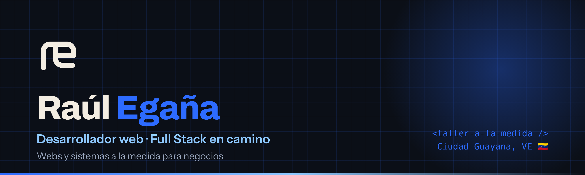
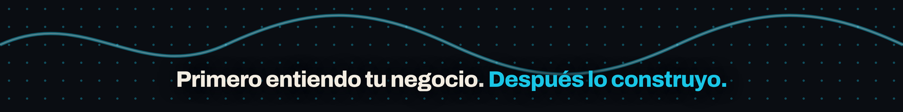

### ¡Hola! 👋 Soy Raúl
**Desarrollador web en Ciudad Guayana, Venezuela 🇻🇪**
*Código, creatividad y soluciones que impulsan negocios.*

---

## 🧰 Sobre mí

- 🎓 Estudiante de **Informática en la UNEG**.
- 🛠️ Construyo **webs, landing pages y sistemas de gestión** (inventario, compras, proveedores) para pymes.
- 💡 Mi forma de trabajar: **primero entiendo tu negocio, después lo construyo.**
- 🌱 Aprendiendo **React, Python y PostgreSQL**.
- 🎯 Meta: **Senior Full Stack Developer.**
- 📍 Ciudad Guayana → Venezuela → clientes de todo el mundo.

## 🚀 Lo que hago

| 🌐 Webs y landing pages | 📦 Sistemas a la medida | 📱 Redes y contenido |
|:--|:--|:--|
| Sitios rápidos, claros y pensados para vender. | Inventario, compras y proveedores sin hojas de Excel sueltas. | Contenido que enseña cómo se construye, paso a paso. |

## ⚙️ Stack

**Aprendiendo →**

## 📌 Proyectos destacados

> Reemplaza los enlaces por tus repos reales (y fíjalos con *Customize your pins*).

<table>
<tr>
<td width="50%">

**🏍️ Panda Biker**
Proyecto web a la medida.
`HTML` `CSS` `JS`
[Ver repo →](https://github.com/eganaraul7/PandaBiker)

</td>
<td width="50%">

**📦 Tu Parley**
Sistema de parley completo.
`Nodejs` `React`
[Ver repo →](https://github.com/eganaraul7/TuParley)

</td>
</tr>
</table>

## 📊 GitHub

## 🤝 ¿Tienes un negocio?

**Cuéntame qué necesitas y lo construimos a tu medida.**

